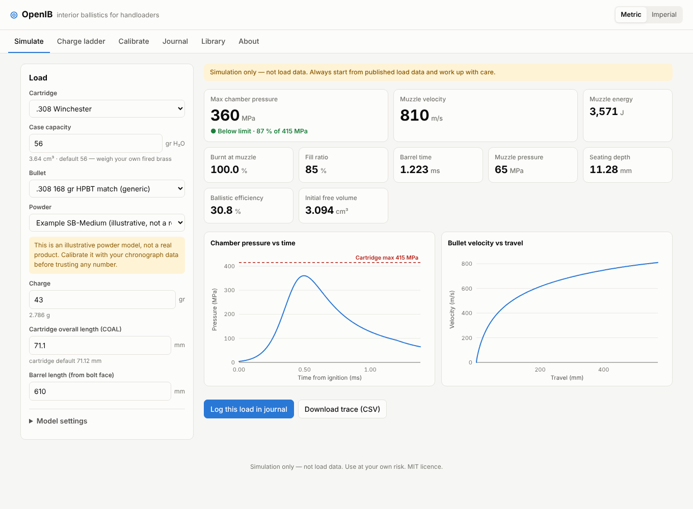

# OpenIB

**Open-source interior ballistics simulator for handloaders.** Runs entirely in the browser, with no installation and no server.



OpenIB predicts the chamber pressure curve, muzzle velocity and powder burn of a rifle cartridge load. It is inspired by tools such as Gordon's Reloading Tool and QuickLOAD. All code, physics and data here are original and openly documented.

> ⚠️ **Simulation only, not load data.** Predicted pressures can differ a lot from real pressures. The bundled powder models are *illustrative examples, not real products*. Always start from load data published by the powder or bullet manufacturer. Start low, work up in small steps and watch for pressure signs. Excess pressure can destroy a firearm and cause serious injury or death. See [Disclaimer](#disclaimer).

## Features

- **Simulation**: peak chamber pressure, muzzle velocity and energy, burnt fraction at the muzzle, fill ratio, barrel time, muzzle pressure and efficiency. Includes a pressure–time curve and a velocity–travel curve, plus a CSV export of the full trace.
- **Charge ladder**: simulates a range of charges and colour-codes each row against the cartridge's maximum pressure. It can also find the charge for a target pressure.
- **Calibration**: fits a powder model to your own chronograph data (burn rate only, or burn rate plus impetus) and saves the result as a new powder.
- **Load journal**: records loads, chronograph strings (mean, SD, ES), groups and notes. Entries can be sent back to the simulator, used as calibration input or exported as CSV.
- **Component library**: cartridges, bullets and powders. You can duplicate and edit them, and back up or move your data as JSON.
- Metric and imperial units, light and dark themes, works on phones.
- No tracking and no backend. Your data stays in your browser's `localStorage`.

## Quick start

```bash
npm install
npm run dev        # http://localhost:5173
npm test           # unit tests (physics, calibration, stats)
npm run build      # static site in dist/
```

### Deploy to GitHub Pages

The repository includes `.github/workflows/deploy.yml`. In **Settings → Pages**, choose **GitHub Actions** as the source. Every push to `main` then builds and publishes the app to `https://<user>.github.io/<repo>/`.

## How it works

OpenIB uses a classic *lumped-parameter* interior ballistics model, integrated with 4th-order Runge–Kutta:

| Part | Model |
|---|---|
| Burn law | `dZ/dt = B · (p/1 MPa)^n` |
| Grain geometry | form function `ψ(Z) = χZ(1 + λZ + μZ²)` |
| Gas | Noble–Abel equation of state with co-volume |
| Energy | propellant energy − bullet & gas kinetic energy − bore friction − heat loss |
| Pressure gradient | Lagrange approximation (breech / mean / base pressure) |
| Start | primer ignition pressure, shot-start (engraving) pressure |

The full derivation, assumptions and limitations are in [docs/MODEL.md](docs/MODEL.md). The data formats are described in [docs/DATA.md](docs/DATA.md).

The model is checked against an analytic adiabatic-expansion solution and for time-step convergence in `tests/core.test.ts`.

## Project layout

```
src/core/      physics & numerics (pure TypeScript, no DOM – usable in Node)
src/data/      built-in cartridges, bullets, illustrative powders (JSON)
src/store/     localStorage persistence, JSON import/export
src/ui/        dependency-free UI (views, SVG charts)
tests/         Vitest unit tests
docs/          model and data documentation
```

The core library has no dependencies. You can use it in your own scripts:

```ts
import { simulate } from './src/core';
const r = simulate({ cartridge, bullet, powder, chargeGr: 43, coal: 71.1, barrelLength: 610 });
console.log(r.maxPressure, r.muzzleVelocity);
```

## Contributing

Contributions are welcome, especially:

- Measured case capacities and bullet dimensions (state your source)
- Powder models **derived from your own measurements** (chronograph and, ideally, pressure-trace data), with the raw data attached
- Model improvements, such as temperature sensitivity, a better heat-transfer model, multi-perforated grains and barrel time / OBT tools
- Translations

Please read [CONTRIBUTING.md](CONTRIBUTING.md). **Do not submit powder data copied from commercial or proprietary programs** (QuickLOAD, GRT databases and similar). Only submit data you have the right to publish under the MIT licence.

## Disclaimer

This software is provided "as is", without warranty of any kind. It is a simulation and an educational tool, not a source of reloading data. The authors and contributors accept no responsibility for any damage, injury or death resulting from its use. Handloading is done entirely at your own risk and in compliance with your local laws.

## Licence

[MIT](LICENSE)
